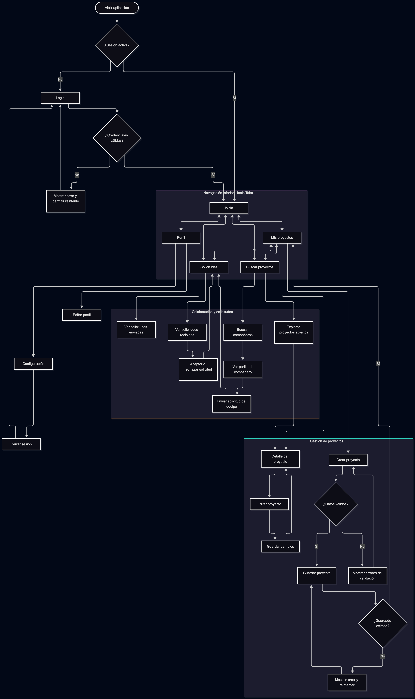

| Pantalla               | Problema                                                                                                                                                                                    | Principio                                  | Severidad | Arreglo propuesto                                                                                                                                                                                                    |
| ---------------------- | ------------------------------------------------------------------------------------------------------------------------------------------------------------------------------------------- | ------------------------------------------ | --------- | -------------------------------------------------------------------------------------------------------------------------------------------------------------------------------------------------------------------- |
| Login                  | No existe una pantalla de acceso diseñada, por lo que no se han definido los campos, las validaciones ni los mensajes de error.                                                             | Estados de la interfaz y retroalimentación | Alta      | Diseñar el Login con campos de correo y contraseña, validación en línea, indicador de carga y mensajes claros para errores de autenticación.                                                                         |
| Login                  | No se ha definido cómo se recupera el acceso cuando el usuario olvida su contraseña.                                                                                                        | Navegación y prevención de errores         | Media     | Añadir la opción «¿Olvidaste tu contraseña?» y diseñar el flujo de recuperación con confirmación del envío.                                                                                                          |
| Inicio                 | La pantalla presenta muchas secciones consecutivas: wireframes, proyecto creado, recomendaciones y proyectos abiertos. Esto puede dificultar identificar la acción principal.               | Jerarquía visual                           | Media     | Priorizar el proyecto activo y la acción principal; agrupar recomendaciones y proyectos abiertos en secciones secundarias con una jerarquía visual consistente.                                                      |
| Inicio                 | Las tarjetas de compañeros recomendados muestran información truncada, como «React · UI/UX Design · S...».                                                                                  | Legibilidad y diseño adaptable             | Media     | Mostrar menos etiquetas, ajustar su distribución en varias líneas o permitir consultar el perfil para ver las habilidades completas.                                                                                 |
| Inicio                 | Los indicadores «76% Match», «74% Match» y «66% Match» no explican qué representa el porcentaje ni cómo se calcula.                                                                         | Claridad y comunicación del sistema        | Baja      | Añadir una explicación breve, por ejemplo, «Compatibilidad según habilidades e intereses», y ofrecer más detalles cuando sea pertinente.                                                                             |
| Mis proyectos          | Los botones «Find Teammates» y «Requests» aparecen juntos dentro de cada tarjeta, con textos e iconos que compiten por la atención.                                                         | Jerarquía visual y consistencia            | Media     | Definir una acción principal y otra secundaria, manteniendo estilos diferenciados y áreas táctiles cómodas.                                                                                                          |
| Mis proyectos          | El texto descriptivo del proyecto se corta con puntos suspensivos, lo que impide conocer toda la descripción desde la lista.                                                                | Legibilidad y control del usuario          | Baja      | Mostrar una descripción resumida de longitud consistente y permitir consultar la descripción completa en el detalle del proyecto.                                                                                    |
| Inicio y Mis proyectos | La navegación inferior tiene cinco opciones, algunas con etiquetas de dos líneas, como «My Projects» y «Find Projects», que pueden dificultar la lectura y selección en pantallas pequeñas. | Navegación, accesibilidad y áreas táctiles | Media     | Verificar que cada elemento tenga un área táctil mínima recomendada de 44 × 44 pt en iOS y, preferiblemente, al menos 48 × 48 dp en Android; mantener etiquetas legibles y estados activos claramente diferenciados. |

